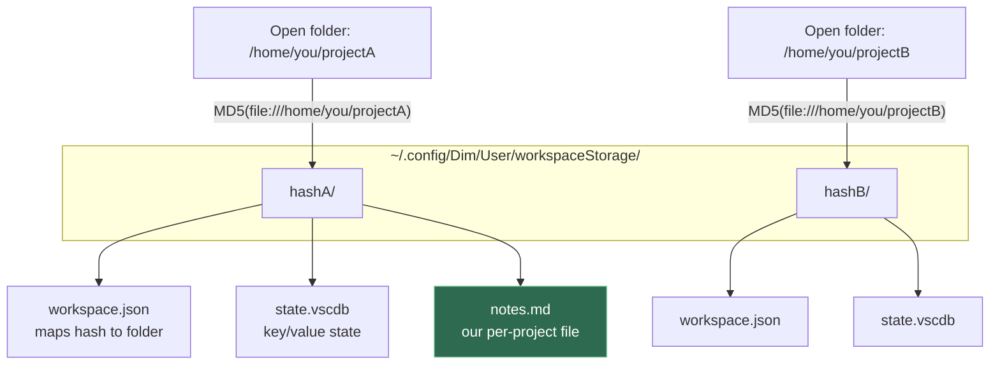
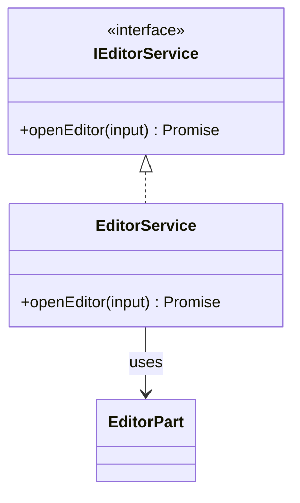
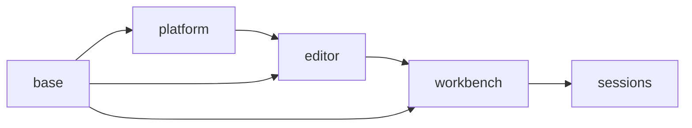
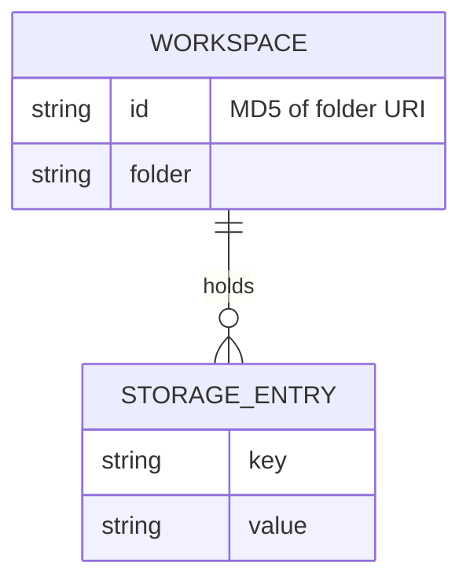
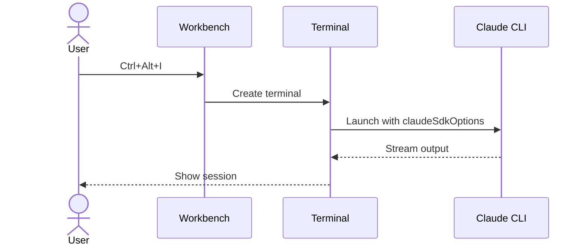
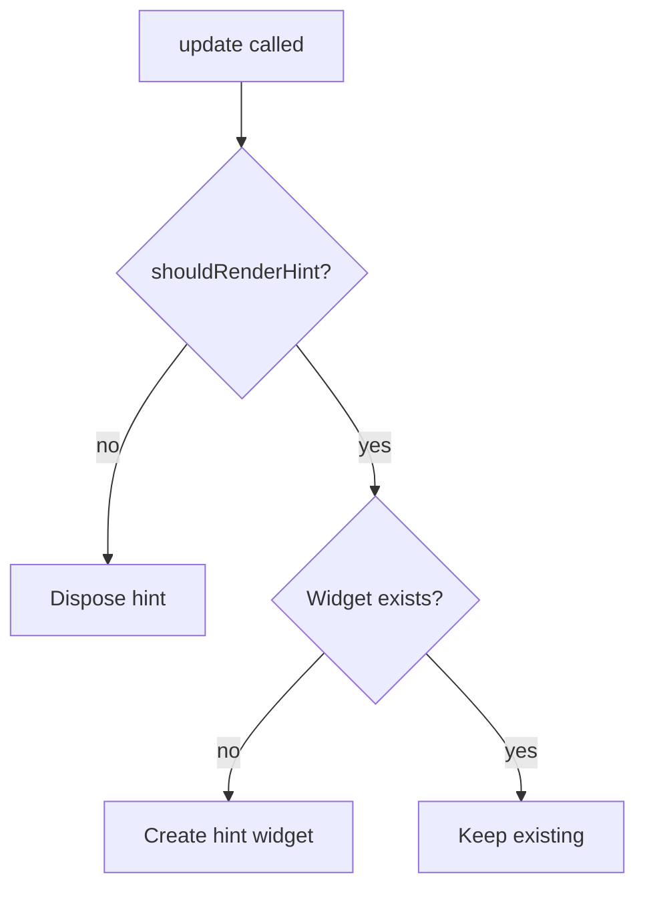
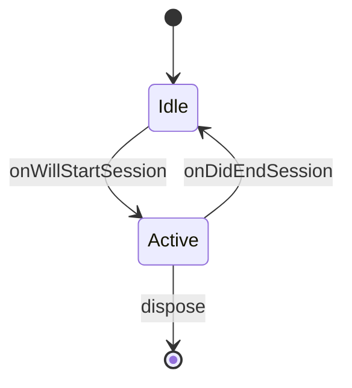

# File System Storage Notes

Where Dim (this VS Code fork) stores project-related files, and how to persist our own per-project data.

## TODO
- [ ] check for changes since last commit and make sure diagrams are up to date based on the files changed
- [ ] when the user pulls chekc if any diagrams exist for the files cahnge and if so make sure to update them based on the changse
- [ ] clickable diagrams control+f for flow diagram for a function, just clicking on the function shows the code. Clicking on a box should show the microservice or open the class file?
- [ ] on clicking on a file it should open the file.dim file.

## Product naming (from `product.json`)

| Field | Value | Used for |
|---|---|---|
| `nameLong` | `Dim` | User-data directory name |
| `applicationName` | `dim` | CLI binary name |
| `dataFolderName` | `.dim` | Extensions folder in `$HOME` |
| `serverDataFolderName` | `.dim-server` | Server-side data folder |

## Two places project state lives

### 1. Inside the project folder

- `.vscode/` — the only project data committed to the repo: `settings.json`, `launch.json`, `tasks.json`, `extensions.json`.

### 2. Per-workspace state in the user-data directory

The user-data root is the same for every project you open; each opened folder just gets its own hashed subfolder beneath it. It does **not** create a new config directory per project.

Platform roots:

- **Linux:** `~/.config/Dim/` (or `$XDG_CONFIG_HOME/Dim/`)
- **macOS:** `~/Library/Application Support/Dim/`
- **Windows:** `%APPDATA%\Dim\`

Project-scoped contents under that root:

```
~/.config/Dim/
└── User/
    └── workspaceStorage/
        ├── <hash-of-folderA>/
        │   ├── workspace.json   { "folder": "file:///home/you/projectA" }
        │   └── state.vscdb      per-workspace key/value state (SQLite)
        └── <hash-of-folderB>/
            ├── workspace.json   { "folder": "file:///home/you/projectB" }
            └── state.vscdb
```

The same layout as a diagram (open the Markdown preview with Ctrl+Shift+V to see it render):



- `<hash>` is an **MD5 of the folder's URI** (e.g. `file:///home/you/projectB`). Each distinct folder → distinct hash → its own subfolder.
- `workspace.json` records which folder/workspace a hash maps to.
- Multi-root / `.code-workspace` files are hashed by the workspace file's URI instead of a single folder.
- This state is **persistent** (survives restarts) and **not auto-cleaned** — stale entries accumulate even after a project folder is deleted.

Other (non-per-project) neighbors in the same root: `User/settings.json`, `User/keybindings.json`, `User/globalStorage/`, `Backups/` (hot-exit unsaved files), `User/History/` (timeline), `logs/`.

Extensions install to `$HOME` instead: `~/.dim/extensions/`.

## Storing our own per-project data

### Key/value → `IStorageService`

The hash is handled for us; never compute it.

```typescript
constructor(@IStorageService private readonly storageService: IStorageService) {}

// per-project (lands in this workspace's state.vscdb)
this.storageService.store('myKey', value, StorageScope.WORKSPACE, StorageTarget.MACHINE);

// shared across all projects
this.storageService.store('myKey', value, StorageScope.PROFILE, StorageTarget.MACHINE);

const value = this.storageService.get('myKey', StorageScope.WORKSPACE);
```

### Files (e.g. a per-project `.md`) → `IFileService`

The per-workspace folder is `workspaceStorageHome / <workspace.id>`, where `workspace.id` **is** the on-disk hash.

- `workspaceStorageHome` comes from `IWorkbenchEnvironmentService` (`environmentService.ts:119` → `joinPath(userRoamingDataHome, 'workspaceStorage')`).
- `workspace.id` comes from `IWorkspaceContextService.getWorkspace().id`.

```typescript
import { joinPath } from '../../../../base/common/resources.js';
import { VSBuffer } from '../../../../base/common/buffer.js';
import { IFileService } from '../../../../platform/files/common/files.js';
import { IWorkbenchEnvironmentService } from '../../../services/environment/common/environmentService.js';
import { IWorkspaceContextService } from '../../../../platform/workspace/common/workspace.js';

constructor(
    @IFileService private readonly fileService: IFileService,
    @IWorkbenchEnvironmentService private readonly environmentService: IWorkbenchEnvironmentService,
    @IWorkspaceContextService private readonly contextService: IWorkspaceContextService,
) {}

private get notesUri() {
    const workspaceId = this.contextService.getWorkspace().id;   // the hash
    return joinPath(this.environmentService.workspaceStorageHome, workspaceId, 'notes.md');
}

async writeNotes(markdown: string): Promise<void> {
    await this.fileService.createFile(this.notesUri, VSBuffer.fromString(markdown), { overwrite: true });
}

async readNotes(): Promise<string | undefined> {
    try {
        const content = await this.fileService.readFile(this.notesUri);
        return content.value.toString();
    } catch {
        return undefined; // not created yet
    }
}
```

Result lands at `~/.config/Dim/User/workspaceStorage/<hash>/notes.md`, automatically scoped to the open project.

### Gotchas

- Use `IFileService`, not `node:fs` — it works in web/remote, resolves the scheme, and creates missing parent directories.
- A raw file dropped in `workspaceStorage` is **not** auto-cleaned (unlike `state.vscdb` keys); it persists until deleted.
- **Empty window:** with no folder/workspace open, `getWorkspace().id` is the empty-window id and the file goes into a bucket that may be recycled. Guard on `getWorkbenchState() !== WorkbenchState.EMPTY` if the feature only makes sense with a folder open.

## Code entity → diagram mapping

Each code "thing" maps to the diagram(s) that fit it. **Primary** = the default view; **Also** = useful when the thing is complex enough to earn it. The **Group** column collects entities that behave alike.

| Group | Code thing | Primary diagram | Also / when complex | Generated by |
|---|---|---|---|---|
| Callable | **Function / method / API / endpoint** (all treated the same for now) | the code itself (leaf) or **flowchart** (branchy) | **sequence** (if it calls ≥2 collaborators) | flowchart → AST; sequence → LSP call-hierarchy + LLM |
| Callable | **Event / message flow** (pub-sub, emitters) | **sequence** (emit → listeners) | **flowchart** (routing logic) | LSP + LLM |
| Code unit | **Class / Service / Subsystem / feature / whole app** (same thing at every scale — from one DI class up to the whole system) | **classDiagram** (members/components + relationships; for a service its **dependency graph**) + **sequence** (an interesting method or key flow) | **state** (modes/lifecycle); **flowchart** / **mindmap** (high-level component or feature graph, for the larger scales) | structure/deps → AST; state/sequence → LSP + LLM |
| Data | **Data model / entity / schema** | **erDiagram** (entities + relationships) | **classDiagram** (if typed objects, not relational) | AST (typed) / schema parse |

**The pattern underneath:** two orthogonal questions decide the diagram, regardless of the entity. **Structure** ("what is it made of?") → `classDiagram` (code), `erDiagram` (data), `flowchart` (subsystems) — *deterministic (AST)*. **Behavior** ("what does it do over time?") → `sequence` (across participants), `flowchart` (within one routine), `state` (modes) — *needs LLM or LSP call-hierarchy*. Every entity gets at most one structure view + at most one behavior view; shape picks the behavior view (branchy → flowchart, fan-out → sequence, stateful → state), and the entity type sets the default and the scope.

**Also worth having:** a **dependency graph** per service (who injects whom — the DI-edge version, not the raw file-import graph, which was dropped as low-value); an **inheritance / implements tree** (focused `classDiagram` for deep hierarchies); and a **call-hierarchy tree** (callers / callees — the raw material the sequence generator sits on, useful on its own for "where is this used?").

## Diagram examples

A sampler of mermaid diagram types, for reference. Open the Markdown preview (Ctrl+Shift+V) to see them rendered.

### Class diagram — type/class structure



### Dependency graph — module layering



### ER diagram — data model



### Sequence diagram — runtime control flow



### Flowchart — branching logic



### State diagram — lifecycle / state machine


