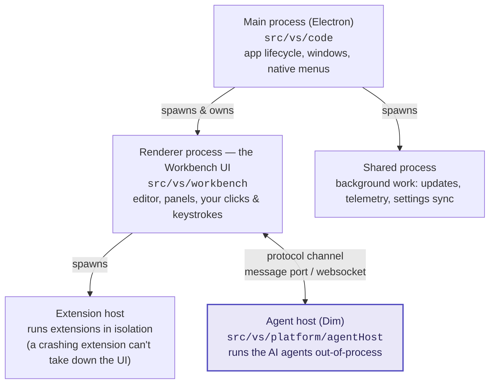
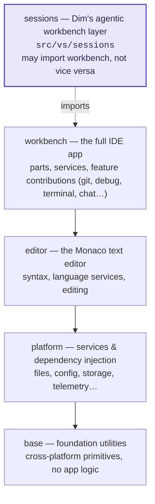
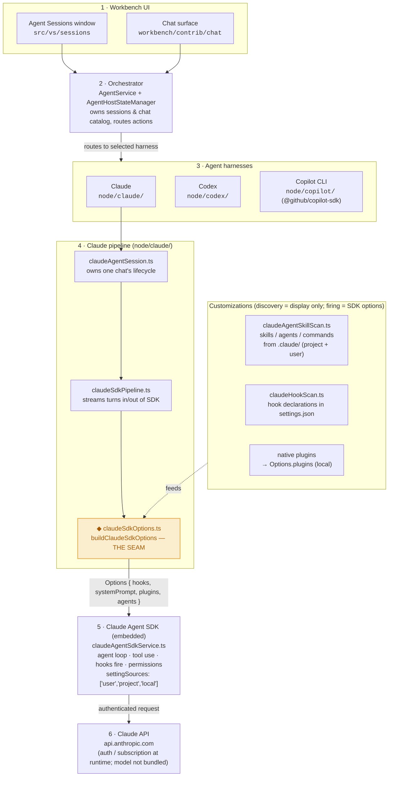

# Dim — Architecture notes

Two views here:

1. **[Big-picture VS Code](#1--big-picture-vs-code)** — the layers and processes Dim inherits from VS Code.
2. **[The agent host](#2--the-agent-host-how-claude-runs)** — how Claude runs natively inside it, and where the fork's permanent workflow lives.

---

## 1 · Big-picture VS Code

VS Code (and therefore Dim) is a TypeScript app that runs as **several cooperating processes**, built in **layers**. Understanding these two axes explains where any given file lives and what it is allowed to do.

### Process model

| Process | What it is for |
| --- | --- |
| **Main** (`src/vs/code`) | The Electron entry point. Owns the application lifecycle, creates windows, and talks to the OS (menus, dialogs, protocol handlers). Thin — most logic lives elsewhere. |
| **Renderer** (`src/vs/workbench`) | The window you look at. Renders the editor, side bar, panels, status bar — everything you interact with. One renderer per window. |
| **Extension host** | A separate process that runs extensions, so a buggy extension can't freeze or crash the UI. Extensions talk to the workbench through the stable VS Code API (`src/vs/workbench/api`). |
| **Shared process** | One background process shared by all windows for work that shouldn't be duplicated: updates, telemetry, settings sync, extension management. |
| **Agent host** (`src/vs/platform/agentHost`) — *the big add in Dim* | Runs the AI coding agents (Claude, Codex, Copilot CLI) **out-of-process**, communicating with the workbench over a protocol channel. Keeps heavy agent work off the UI thread. |

### Layered architecture

Code is organized in layers; a layer may only depend on the ones below it. This is what keeps the editor reusable (it runs in the browser too) and the core portable.

| Layer | What it is for |
| --- | --- |
| **`base`** | Lowest level. Generic utilities and cross-platform abstractions (events, disposables, paths). No knowledge of the editor or the app. |
| **`platform`** | Services wired together with **dependency injection** — file system, configuration, storage, logging, telemetry. The **agent host lives here** (`platform/agentHost`). |
| **`editor`** | The Monaco code editor: text model, syntax highlighting, language features. Reusable on its own (it's the same editor as monaco-editor on the web). |
| **`workbench`** | The whole IDE assembled from the layers below, via the **contribution model** — features register themselves into registries (an editor, a view, a command) rather than being hard-wired. |
| **`sessions`** *(Dim)* | A dedicated workbench layer for agentic workflows. Sits alongside `workbench`, may import from it, but `workbench` must not import from it. |

**Two cross-cutting ideas** to know when reading any file:

- **Dependency injection** — services are requested through constructor parameters (`@IFileService`), never imported directly. Service params come last in a constructor.
- **Target environments** — a folder suffix says where code runs: `common/` (anywhere), `browser/` (renderer/web), `node/` (Node process), `electron-main/` / `electron-browser/` (Electron). A file can only import from an environment at least as permissive as its own.

---

## 2 · The agent host — how Claude runs

Claude is **not** an extension bolted on; it is native platform code under `src/vs/platform/agentHost/`.
A prompt flows down through the tiers below to the Anthropic API. The tier to customize for the
Dim fork is `claudeSdkOptions.ts` (`buildClaudeSdkOptions`) — the **seam** highlighted in amber.

### What each part is for

| # | Part | What it is for |
| --- | --- | --- |
| 1 | **Workbench UI** — Agent Sessions window + chat surface | Where you type. The sessions window is Dim's dedicated agentic surface; the chat surface captures the prompt and renders turns, tool calls, and diffs. |
| 2 | **Orchestrator** — `AgentService` + `AgentHostStateManager` | Owns the session and its catalog of chats, and routes each action to the chosen harness. Principle: *"represent, don't orchestrate"* — no agent-specific logic leaks in here, so all three backends share one uniform surface. |
| 3 | **Agent harnesses** — Claude / Codex / Copilot CLI | Three independent backends. Each adapts one provider's protocol to the orchestrator's uniform chat seam. **Claude** talks to Anthropic's own SDK — it does *not* run through the Copilot harness. |
| 4 | **Claude pipeline** (`node/claude/`) | The Claude lane's internals: `claudeAgentSession.ts` owns one chat's lifecycle and assembles state; `claudeSdkPipeline.ts` streams turns into and out of the SDK; `claudeSdkOptions.ts` builds the options object for every session. |
| — | **Customization feeds** | `claudeAgentSkillScan.ts` discovers skills/agents/commands from `.claude/` (project + user scope); `claudeHookScan.ts` discovers hook declarations. These are **discovery only** — they populate the workbench UI. What makes hooks *fire* and skills/agents reach the model is the SDK options object at the seam. Native plugins are projected onto `Options.plugins`. |
| 5 | **Claude Agent SDK** (embedded, `claudeAgentSdkService.ts`) | Runs the actual agent loop: tool use, firing hooks (`settingSources: ['user','project','local']`), permission checks, file checkpointing. |
| 6 | **Claude API** (`api.anthropic.com`) | The model. Needs auth/subscription at runtime — the *plumbing* is baked into Dim, the model is not bundled. |

### Where the fork's permanent workflow lives

Every Claude session passes through `buildClaudeSdkOptions` in
[`src/vs/platform/agentHost/node/claude/claudeSdkOptions.ts`](../src/vs/platform/agentHost/node/claude/claudeSdkOptions.ts).
Encode the workflow here and it is compiled into Dim — always on, un-removable, no `~/.claude`
required, and not a toggleable plugin.

| Lever | Use for |
| --- | --- |
| `hooks{}` | Always-on `Stop` / `PreToolUse` / `PostToolUse` / `UserPromptSubmit` handlers, in code. |
| `appendSystemPrompt` | Permanent workflow instructions injected into every turn. |
| `Options.agents` | Baked-in agents & skills defined in code, not discovered from disk. |
